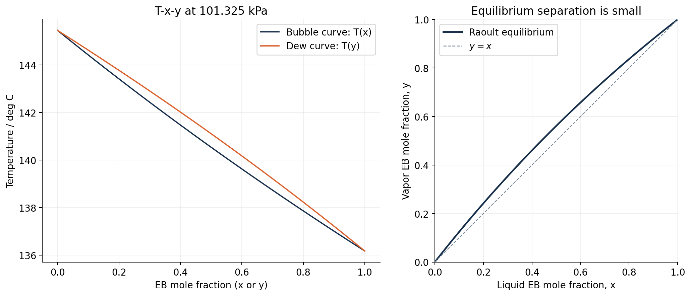
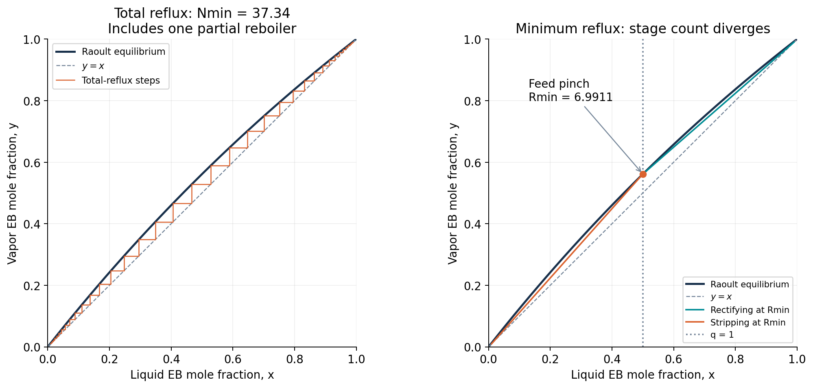
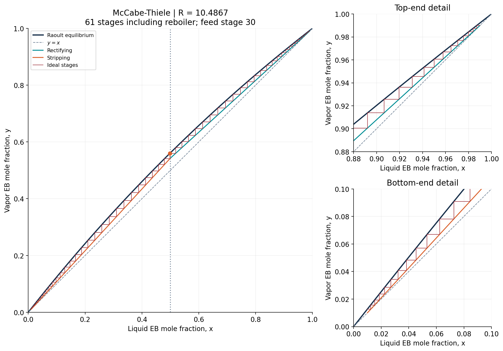
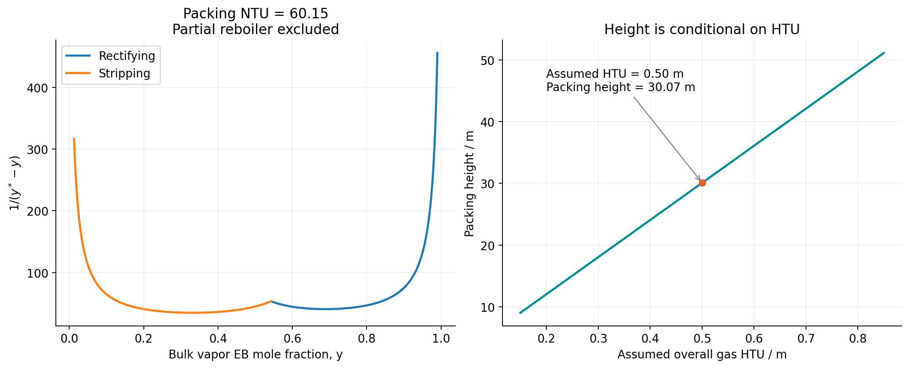
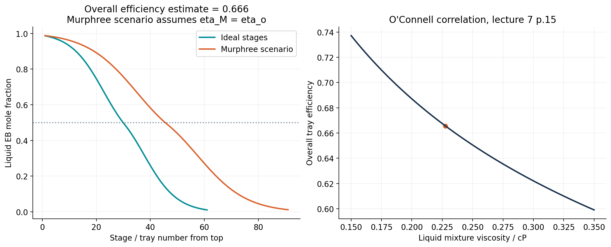
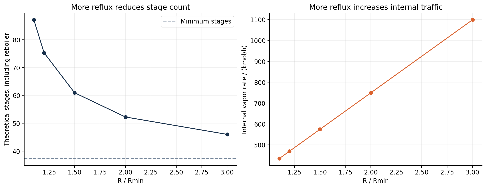

# 에틸벤젠–스타이렌 상압 증류 예비설계

## 1. 설계 조건과 계산 범위

에틸벤젠(EB)과 스타이렌 모노머(SM)를 연속 증류하여 EB를 탑정으로, SM을 탑저로 회수한다.

중합을 무시하고 정상상태·상압에서 계산한다. 모든 조성은 EB의 몰분율이며, 원료의 1:1은 몰비로 해석한다.

| 항목 | 기호 | 설계값 | 설정 근거 |
|---|---|---:|---|
| 원료 유량 | $F$ | 100 kmol/h | 계산 기준으로 선택 |
| 원료 EB 몰분율 | $z_F$ | 0.50 | 지정한 1:1 몰비 |
| 탑정 EB 몰분율 | $x_D$ | 0.99 | 지정한 분리 목표 |
| 탑저 EB 몰분율 | $x_B$ | 0.01 | 잠정 가정: SM 99 mol% |
| 운전압력 | $P$ | 101.325 kPa | 초기 계산에서 압력강하 무시 |
| 급료 상태 | $q$ | 1 | 포화액체 |
| 응축기 | — | 전응축기 | 평형단수에서 제외 |
| 재비기 | — | 평형 부분재비기 | 평형단수에 1단 포함 |
| 상평형 모델 | — | Raoult 법칙 | 이상액상·이상기상 가정 |
| 내부 유량 | — | 일정몰유량 | 정류부·회수부 각각 적용 |

Raoult 모델은 이번 예비설계의 가정이며, EB–SM 혼합물 실험자료로 검증한 결과는 아니다.

NTU는 조작선에 의존하므로 환류비를 먼저 결정해야 한다. 따라서 계산 순서는 다음과 같다.

1. 물성과 기액평형
2. 전체 물질수지
3. 최소환류비와 최소단수
4. 운전환류비와 McCabe–Thiele 작도
5. 충전탑의 NTU·HTU
6. 단탑의 단효율과 실제 트레이 수

충전탑의 NTU–HTU 계산과 단탑의 단효율 계산은 같은 분리 목표에 대한 두 가지 장치화 경로다. 두 결과를 한 장치의 크기로 합산하지 않는다.

## 2. 강의자료와 계산의 연결

페이지는 PDF 뷰어에서 세는 페이지다. 증류 계산식과 단효율 식이 있는 같은 강의의 자료 6·7을 함께 사용하였다.

| 계산 항목 | 강의자료 | 적용 내용 |
|---|---|---|
| 증기압·상평형·상대휘발도 | `SeparationProcess1.pdf`, pp.28–33 | $K$값, Raoult 법칙, 상대휘발도 |
| 전체 물질수지 | `SeparationProcess6(1).pdf`, p.9 | 전체 및 성분 수지 |
| 조작선·환류비 | 자료 6, pp.11–18 | 정류부·회수부 조작선 |
| 급료 상태·q선 | 자료 6, pp.19–23 | 급료에 의한 내부 유량 변화 |
| 최소단수 | 자료 6, pp.25–26 | 전환류, Fenske 식 |
| 최소환류비 | 자료 6, pp.27–28 | 핀치 조건 |
| 환류비 비교 | 자료 6, p.29 | 단수와 내부 유량의 절충 |
| NTU·HTU | `SeparationProcess3.pdf`, pp.18–21 | 물질전달 구동력과 충전높이 |
| 단효율 | `SeparationProcess7.pdf`, pp.9–16 | 전체·Murphree·국소 효율 |

## 3. 증기압과 기액평형

### 3.1 증기압식

자료 1 p.32의 확장 Antoine 식과 같은 계열인 DIPPR 101 형태를 사용한다.

$$
\ln(P_i^{sat}/\mathrm{Pa})=A_i+\frac{B_i}{T}+C_i\ln T+D_iT^{E_i}
$$

$T$는 K 단위의 수치다.

계수는 `chemicals 1.5.2`의 `Psat_data_Perrys2_8`에서 확인한 Perry 8판 데이터다.

| 성분 | $A$ | $B$ | $C$ | $D$ | $E$ | 수록 온도 범위, K |
|---|---:|---:|---:|---:|---:|---:|
| EB | 89.063 | -7733.7 | -9.917 | 0.000005986 | 2 | 178.2–617.15 |
| SM | 105.93 | -8685.9 | -12.42 | 0.0000075583 | 2 | 242.54–636.0 |

두 계수식 모두 이번 계산의 온도 범위를 포함한다.

자연로그와 Pa 단위를 사용하므로 상용로그·bar 단위의 Antoine 계수와 혼용하지 않는다.

### 3.2 기포점 계산

자료 1 p.33의 Raoult 법칙으로

$$
K_i=\frac{P_i^{sat}(T)}{P}
$$

각 액상 조성 $x$에서 다음 기포점 방정식을 푼다.

$$
xP_{EB}^{sat}(T)+(1-x)P_{SM}^{sat}(T)=P
$$

Python에서는 `scipy.optimize.brentq`를 사용하였다.

계산한 온도에서 평형 기상 조성과 상대휘발도는

$$
y^*(x)=\frac{xP_{EB}^{sat}[T(x)]}{P}
$$

$$
\alpha(x)=\frac{P_{EB}^{sat}[T(x)]}{P_{SM}^{sat}[T(x)]}
$$

이다.

| 액상 EB 몰분율 $x$ | 기포점, °C | 평형 기상 EB 몰분율 $y^*$ | 상대휘발도 |
|---:|---:|---:|---:|
| 0.01 | 145.347 | 0.012712 | 1.274682 |
| 0.50 | 140.534 | 0.561318 | 1.279556 |
| 0.99 | 136.251 | 0.992195 | 1.284137 |

따라서 포화액체 원료의 온도는 140.534 °C다.

136.251 °C는 탑정 제품·환류액의 기포점이다. $y=0.99$인 탑정 증기의 이슬점은 약 136.274 °C다.

Fenske 식에 사용할 대표 상대휘발도는 양 끝 조성에서의 기하평균으로 정한다.

$$
\bar\alpha=\sqrt{\alpha(x_D)\alpha(x_B)}=1.279401
$$

실제 계단 작도와 NTU 적분에서는 평균 상대휘발도로 평형선을 대체하지 않고, 조성별 기포점 계산으로 얻은 $y^*(x)$를 사용한다.

이 모델에서는 목표 조성 구간에서 $y^*>x$이며 공비점이 나타나지 않는다.



## 4. 전체 물질수지

자료 6 p.9의 식을 적용한다.

$$
F=D+B
$$

$$
Fz_F=Dx_D+Bx_B
$$

따라서

$$
D=F\frac{z_F-x_B}{x_D-x_B}
=100\frac{0.50-0.01}{0.99-0.01}
=50.00\ \mathrm{kmol/h}
$$

$$
B=F-D=50.00\ \mathrm{kmol/h}
$$

이다.

| 흐름 | 전체, kmol/h | EB, kmol/h | SM, kmol/h |
|---|---:|---:|---:|
| 원료 | 100.00 | 50.00 | 50.00 |
| 탑정 | 50.00 | 49.50 | 0.50 |
| 탑저 | 50.00 | 0.50 | 49.50 |

EB의 탑정 회수율과 SM의 탑저 회수율은 각각 99.0%다.

## 5. q선과 최소환류비

자료 6 pp.19–21에서 포화액체 급료는

$$
q=1,\qquad \bar L=L+F,\qquad \bar V=V
$$

이다. 따라서 q선은 다음 수직선이다.

$$
x=z_F=0.50
$$

q선과 평형선의 교점은

$$
(x_p,y_p)=(0.50,0.561318)
$$

이다.

자료 6 p.27의 최소환류비 식을 적용한다.

$$
R_{min}=\frac{x_D-y_p}{y_p-x_p}
$$

$$
R_{min}
=\frac{0.99-0.561318}{0.561318-0.50}
=6.991108
$$

이때 정류부 조작선은 $(x_D,x_D)$와 핀치점을 잇는다. 회수부 조작선은 핀치점과 $(x_B,x_B)$를 잇는다.

평형선 전체를 확인했을 때 다른 조성의 핀치가 먼저 제한하지 않았다.

$R=R_{min}$에서는 핀치의 물질전달 구동력이 0이 되어 유한한 단수로 목표 분리를 달성할 수 없다.

## 6. 최소단수

### 6.1 Fenske 식

전환류에서는 정류부와 회수부 조작선이 모두 대각선 $y=x$가 된다.

자료 6 p.26의 식은 재비기를 제외한 트레이 수를 나타내므로 마지막에 $-1$이 들어간다.

$$

N_{min,tray}=
\frac{\ln\left[\dfrac{x_D(1-x_B)}{x_B(1-x_D)}\right]}
{\ln\bar\alpha}-1

$$

수치를 대입하면

$$
N_{min,tray}=
\frac{\ln(9801)}{\ln(1.279401)}-1=
36.2993
$$

이다.

재비기를 포함하면

$$
N_{min,total}=37.2993
$$

이다.

### 6.2 전환류 작도로 확인

조성별 상대휘발도를 유지한 평형선으로 전환류 계단 작도를 하면 약 37.3378단이다.

마지막 부분단은 액상 조성에 대한 선형 보간으로 계산했다.

| 방법 | 재비기 제외 | 재비기 포함 |
|---|---:|---:|
| Fenske 식 | 36.2993 | 37.2993 |
| 조성별 평형선 전환류 작도 | 36.3378 | 37.3378 |
| 정수 단수 | 이론 트레이 37개 | 트레이 37개 + 재비기 1개 |

전환류는 분리 한계를 구하는 계산이며, 제품을 연속 인출하는 실제 운전점은 아니다.



## 7. 운전환류비와 조작선

초기 운전점으로 다음 값을 선택한다.

$$
R=1.5R_{min}=10.486662
$$

경제성 계산으로 구한 최적값은 아니며, 뒤의 민감도 분석에서 다른 환류비와 비교한다.

### 7.1 내부 유량

자료 6 pp.14, 19–21의 식을 적용한다.

$$
L=RD=524.3331\ \mathrm{kmol/h}
$$

$$
V=(R+1)D=574.3331\ \mathrm{kmol/h}
$$

$q=1$이므로

$$
\bar L=L+F=624.3331\ \mathrm{kmol/h}
$$

$$
\bar V=V=574.3331\ \mathrm{kmol/h}
$$

이다.

일정몰유량 가정은 각 구간에서 액체·증기 유량이 일정하다는 의미다. $L=V$라는 의미는 아니다.

### 7.2 정류부 조작선

$$
y_R(x)=\frac{R}{R+1}x+\frac{x_D}{R+1}
$$

$$
y_R(x)=0.91294251x+0.08618692
$$

### 7.3 회수부 조작선

$$
y_S(x)=\frac{\bar L}{\bar V}x-\frac{Bx_B}{\bar V}
$$

$$
y_S(x)=1.08705749x-0.000870575
$$

두 조작선은 q선 위에서 만난다.

$$
(x_I,y_I)=(0.500000,0.542658)
$$

## 8. McCabe–Thiele 작도와 급료단

자료 6 pp.12–23의 방법을 사용한다.

1. 전응축기 조건에서 $(x_D,x_D)=(0.99,0.99)$로 시작한다.
2. 수평으로 평형선까지 이동하여 $y_n=y^*(x_n)$을 푼다.
3. 수직으로 조작선까지 이동하여 $y_{n+1}$을 구한다.
4. 급료 부근에서 정류부 조작선에서 회수부 조작선으로 전환한다.
5. 액상 조성이 $x_B=0.01$에 도달할 때까지 반복한다.

일부 계산점은 다음과 같다.

| 위에서 센 평형단 | 액상 $x_n$ | 기상 $y_n$ | 설명 |
|---:|---:|---:|---|
| 1 | 0.987195 | 0.990000 | 최상부 트레이 |
| 2 | 0.983929 | 0.987439 | 정류부 |
| 29 | 0.518621 | 0.579610 | 급료 위쪽 |
| 30 | 0.498318 | 0.559658 | 급료단 |
| 31 | 0.479344 | 0.540830 | 급료 아래쪽 |
| 60 | 0.012361 | 0.015703 | 최하부 트레이 부근 |
| 61 | 0.009885 | 0.012566 | 재비기 단계의 정수 작도 끝점 |

마지막 계단이 목표 조성을 조금 지나므로 보간하면

$$
N_{theoretical,total}=60.9536
$$

이다.

따라서 정수 기준은 다음과 같다.

- 이론 트레이 60개
- 부분재비기 1개
- 합계 61평형단
- 급료 위치: 위에서 30번째 이론 트레이
- 전응축기: 평형단수에서 제외

마지막 $x=0.009885$는 정수 작도의 초과분이다. 이를 $D=50$, $x_D=0.99$를 유지한 별도의 정확한 제품 조성으로 해석하지 않는다. 정수단을 확정한 엄밀한 모델에서는 환류비 등을 미세 조정할 수 있다.



## 9. 충전탑으로 구현할 때의 NTU

자료 3 pp.18–21의 물질전달 식을 증류에 적용한다.

자료의 흡수 식에서는 $y-y^*$가 구동력이지만, 여기서는 EB가 액체에서 증기로 이동하므로 $y^*-y$를 사용한다.

위쪽을 높이 $z$의 양의 방향으로 잡으면

$$
V\,dy=K_yaA(y^*-y)\,dz
$$

이다. 따라서

$$
H_{OG}=\frac{V}{AK_ya}
$$

$$
N_{OG}=\int\frac{dy}{y^*(x)-y}
$$

$$
Z=H_{OG}N_{OG}
$$

이다.

$A$는 탑 단면적, $K_ya$는 기상 몰분율 구동력 기준의 총괄 체적 물질전달계수다.

이 적용은 일정몰유량과 기액 간 등몰 교환을 가정한다. 흡수의 희석용질용 물성 상관식을 EB–SM에 그대로 대입한 것은 아니다.

### 9.1 재비기를 제외한 적분 경계

전응축기로 들어가는 증기의 조성은

$$
y_{top}=x_D=0.99
$$

이다.

충전층 바닥으로 들어가는 증기는 재비기의 액체 $x_B$와 평형이다.

$$
y_{reb}=y^*(x_B)=0.01271190
$$

따라서 충전층 하단 기상 조성을 $x_B=0.01$로 두면 안 된다.

충전층에서 재비기로 내려가는 액체의 조성은

$$
x_{pack,bottom}=
\frac{\bar V y_{reb}+Bx_B}{\bar L}=
0.01249472
$$

이다.

이 액체가 재비기에서 추가로 분리되어 탑저 제품 $x_B=0.01$이 된다.

### 9.2 정류부 NTU

정류부 조작선을 역으로 풀면

$$
x_R(y)=\frac{y-0.08618692}{0.91294251}
$$

이다.

이를 이용하여 각 위치에서 액상 조성과 평형 기상 조성을 구한다.

$$
N_{OG,R}
=
\int_{0.54265817}^{0.99}
\frac{dy}{y^*[x_R(y)]-y}
=
30.9908
$$

### 9.3 회수부 NTU

회수부 조작선을 역으로 풀면

$$
x_S(y)=\frac{y+0.000870575}{1.08705749}
$$

이다.

따라서

$$
N_{OG,S}
=
\int_{0.01271190}^{0.54265817}
\frac{dy}{y^*[x_S(y)]-y}
=
29.1590
$$

이다.

총 NTU는

$$
N_{OG,total}=30.9908+29.1590=60.1498
$$

이다.

실제 계산에는 반올림하지 않은 조작선 계수를 사용하였다.

이 NTU에는 부분재비기가 포함되지 않는다. NTU는 이론단수와 다른 값이며, 두 값이 이번 조건에서 비슷한 것은 평형선과 조작선의 형태에 따른 결과다.

## 10. HTU와 충전층 높이

HTU는 원료·제품 조성만으로 결정되지 않는다.

$$
H_{OG}=\frac{V}{AK_ya}
$$

이므로 충전물, 기액 부하, 유효 접촉면적과 물질전달계수가 필요하다.

이번 초기 단계에서는 충전물을 확정하지 않았으므로 다음을 명시적인 설계 가정으로 둔다.

$$
H_{OG,R}=H_{OG,S}=0.50\ \mathrm{m}
\quad\text{(가정값)}
$$

이 값은 강의자료나 EB–SM 실험에서 얻은 확정값이 아니다.

이 가정에서

$$
Z_R=0.50\times30.9908=15.4954\ \mathrm{m}
$$

$$
Z_S=0.50\times29.1590=14.5795\ \mathrm{m}
$$

$$
Z_{packing}=30.0749\ \mathrm{m}
$$

이다.

급료 위치는 충전층 위쪽에서 약 15.50 m, 아래쪽에서 약 14.58 m에 해당한다.

이 높이는 순수 충전층 높이다. 액체 분배기·재분배기 및 상하부 공간을 포함한 전체 탑 높이는 아니다.

| 가정한 $H_{OG}$, m | 순수 충전층 높이, m |
|---:|---:|
| 0.30 | 18.0449 |
| 0.50 | 30.0749 |
| 0.80 | 48.1198 |

현재 확보된 결과는 다음 관계다.

$$
Z=60.1498H_{OG}
$$

실제 충전물의 HTU 또는 $K_ya$를 확보하면 높이를 갱신한다. HETP를 HTU로 그대로 대입하지 않는다.



## 11. 단탑으로 구현할 때의 Stage Efficiency

### 11.1 전체 단효율과 Murphree 효율

자료 7 p.9에서 전체 단효율은

$$
\eta_o
=
\frac{N_{ideal,trays}}{N_{actual,trays}}
$$

이다. 평형 재비기는 양쪽 트레이 수에서 제외한다.

기상 기준 Murphree 효율은

$$
\eta_M
=
\frac{y_n-y_{n+1}}
{y^*(x_n)-y_{n+1}}
$$

이다.

전체 단효율은 탑 전체의 단수비이고, Murphree 효율은 한 트레이의 조성 변화 비율이므로 일반적으로 같지 않다.

### 11.2 액체 점도

O'Connell 식에 사용할 대표 온도를 다음과 같이 정한다.

$$
T_{ref}
=
\frac{T_D+T_B}{2}
=
413.9494\ \mathrm{K}
$$

순수성분 점도는 VDI-PPDS9 식으로 계산한다.

$$
\mu_i
=
E_i\exp\left(A_iX_i^{1/3}+B_iX_i^{4/3}\right)
$$

$$
X_i=\frac{C_i-T}{T-D_i}
$$

아래 계수는 `chemicals 1.5.2`의 `mu_data_VDI_PPDS_7`에서 확인하였다.

| 성분 | $A$ | $B$ | $C$, K | $D$, K | $E$, Pa·s |
|---|---:|---:|---:|---:|---:|
| EB | 1.62469 | 0.79236 | 745.185 | -16.276 | 0.00002899 |
| SM | 2.52817 | 0.19295 | 1189.84 | 44.635 | 0.00000538 |

대표 온도에서

$$
\mu_{EB}=0.224788\ \mathrm{cP}
$$

$$
\mu_{SM}=0.230407\ \mathrm{cP}
$$

이다.

혼합물 점도에는 원료 조성에서의 로그 혼합규칙을 추가로 가정한다.

$$
\ln\mu_L
=
z_F\ln\mu_{EB}
+
(1-z_F)\ln\mu_{SM}
$$

따라서

$$
\mu_L=0.227580\ \mathrm{cP}
$$

이다.

### 11.3 O'Connell 상관식

자료 7 p.15의 식을 사용한다.

$$
\eta_o=0.492(\mu_L\bar\alpha)^{-0.245}
$$

점도 단위는 반드시 cP다.

$$
\eta_o
=
0.492(0.227580\times1.279401)^{-0.245}
=
0.665657
$$

전체 단효율의 추정값은 약 66.6%다.

이는 경험상관식에 의한 예비 추정이며 실제 트레이 시험값은 아니다. 강의자료의 상관식은 bubble-cap tray 자료를 바탕으로 한다.

### 11.4 실제 트레이 수

재비기를 뺀 필요 이론 트레이 수는

$$
N_{ideal,trays}=60.9536-1=59.9536
$$

이다.

따라서

$$
N_{actual,trays}
=
\left\lceil\frac{59.9536}{0.665657}\right\rceil
=
91
$$

이다.

초기 단탑 설계는 실제 트레이 91개와 부분재비기 1개다.

### 11.5 Murphree 효율을 이용한 추가 작도

자료 7 p.14의 초기 설계 근사에 따라, 별도의 비교 계산에서만 다음과 같이 둔다.

$$
\eta_M\approx\eta_o=0.665657
$$

자료 7 p.12의 유효 평형선은

$$
y_{eff}(x)
=
y_{op}(x)
+
\eta_M\left[y^*(x)-y_{op}(x)\right]
$$

이다.

정류부와 회수부에서 각각의 조작선을 사용하며, 재비기에서는 원래 평형선을 사용한다.

이 근사 작도에서도 실제 트레이는 91개이며, 급료 위치는 위에서 약 46번째 트레이로 계산된다.

46번째는 $\eta_M\approx\eta_o$ 근사에 따른 초기 위치다. 이론 급료단 30번째와 구분한다.



### 11.6 국소 NTU와 국소 효율

자료 7 p.16은 액체 조성을 일정하게 보는 국소 접촉 모델에서 다음 관계를 제시한다.

$$
\eta'=1-\exp(-N_{OG,local})
$$

| 한 트레이 국소 접촉의 $N_{OG,local}$ | 국소 효율 $\eta'$ |
|---:|---:|
| 1.0 | 0.6321 |
| 1.5 | 0.7769 |
| 2.0 | 0.8647 |

여기서의 국소 NTU와 충전탑 전체 NTU 60.1498은 서로 다른 범위의 값이다.

충전탑 전체 NTU를 위 식에 넣어 전체 단효율을 계산하면 안 된다. 액체 혼합 조건을 정하지 않고 국소 효율·Murphree 효율·전체 효율을 모두 같다고 놓을 수도 없다.

## 12. 환류비 민감도

자료 6 p.29에 따라 환류비를 바꾸며 단수와 내부 증기량을 비교한다.

아래 이론단수는 재비기를 포함한 부분단 보간값이다.

| $R/R_{min}$ | $R$ | 이론단수 | 내부 증기량, kmol/h | 충전탑 NTU |
|---:|---:|---:|---:|---:|
| 1.10 | 7.6902 | 87.1197 | 434.5110 | 86.3178 |
| 1.20 | 8.3893 | 75.3047 | 469.4665 | 74.4873 |
| 1.50 | 10.4867 | 60.9536 | 574.3331 | 60.1498 |
| 2.00 | 13.9822 | 52.2523 | 749.1108 | 51.4644 |
| 3.00 | 20.9733 | 46.0132 | 1098.6662 | 45.2576 |

환류비가 증가하면 단수는 감소하지만 내부 증기·액체 유량은 증가한다.

$R=1.5R_{min}$은 이번 예비설계의 비교 기준이며, 총 연간비용의 최적값으로 주장하지 않는다.



## 13. 결과 정리

| 항목 | 결과 | 해석 |
|---|---:|---|
| 탑정·탑저 유량 | 각각 50 kmol/h | 물질수지 |
| 급료 온도 | 140.534 °C | 원료 기포점 |
| 탑저 온도 | 145.347 °C | 균일 상압 가정 |
| 최소환류비 | 6.9911 | 급료 핀치 |
| 운전환류비 | 10.4867 | $1.5R_{min}$ |
| 최소 이론단수 | 약 37.3단 | 재비기 포함 |
| 운전 이론단수 | 약 61단 | 이론 트레이 60개 + 재비기 1개 |
| 이론 급료단 | 위에서 30번째 | 평형단 모델 |
| 충전탑 NTU | 60.1498 | 재비기 제외 |
| 충전탑 HTU | 0.50 m | 명시적 가정값 |
| 순수 충전층 높이 | 30.0749 m | 위 HTU 가정에서만 유효 |
| 전체 단효율 | 0.6657 | O'Connell 추정 |
| 실제 트레이 수 | 91개 | 부분재비기 별도 |
| 실제 급료 위치 | 약 46번째 트레이 | $\eta_M\approx\eta_o$ 근사 |

이번 계산은 분리 성능 중심의 예비설계다. 실제 장치의 탑경, flooding·weeping, 압력강하, 응축기·재비기 열부하와 면적은 아직 확정하지 않았다.

충전탑 높이 30.07 m는 실제 트레이 91개의 높이를 의미하지 않는다.

## 14. Python 재현 방법

필요한 파일은 `eb_sm_design.py`와 `requirements.txt`다.

```bash
python -m pip install -r requirements.txt
python eb_sm_design.py
```

탑저 목표와 HTU 가정을 변경하는 예:

```bash
python eb_sm_design.py --x-bottom 0.02 --htu 0.4 --out case_02
```

코드는 다음 결과를 생성한다.

- 기액평형도 및 McCabe–Thiele diagram
- 최소환류비·최소단수
- 구간별 NTU와 가정한 HTU에 따른 높이
- O'Connell 단효율 및 Murphree 근사 작도
- 환류비 민감도
- 단별 조성 CSV와 계산 결과 JSON

전체·성분 물질수지, q선 교점, 양의 구동력, 기포점 방정식 잔차를 확인하였다.

NTU를 $x$와 $y$의 두 적분변수로 각각 계산한 차이는 $2\times10^{-12}$ 미만이었다. 일정 상대휘발도에서 전환류 정수 계단 수와 Fenske 식의 올림값이 일치하는지도 확인하였다.

입력을 변경하면 새 계산 결과를 사용하고, README에 적힌 기존 숫자도 함께 갱신해야 한다.

## 참고자료

1. `SeparationProcess1.pdf`, pp.28–33.
2. `SeparationProcess3.pdf`, pp.18–21.
3. `SeparationProcess6(1).pdf`, pp.9–29.
4. `SeparationProcess7.pdf`, pp.9–16.
5. [Chemicals: Vapor Pressure](https://chemicals.readthedocs.io/chemicals.vapor_pressure.html), `Psat_data_Perrys2_8`.
6. [Chemicals: DIPPR Equations](https://chemicals.readthedocs.io/chemicals.dippr.html), `EQ101`.
7. [Chemicals: Viscosity](https://chemicals.readthedocs.io/chemicals.viscosity.html), `PPDS9`, `mu_data_VDI_PPDS_7`.

증기압 계수의 원출처는 Perry's Chemical Engineers' Handbook, 8th ed., 점도 계수의 원출처는 VDI Heat Atlas, 2nd ed., 2010이다. 본 계산에서는 이를 수록한 chemicals 1.5.2 데이터에서 두 성분의 계수를 추출했다.
