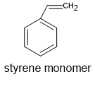
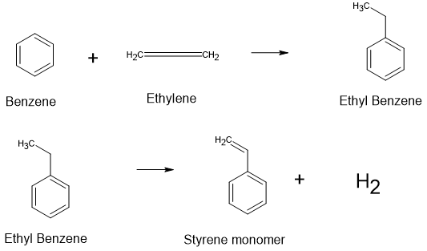
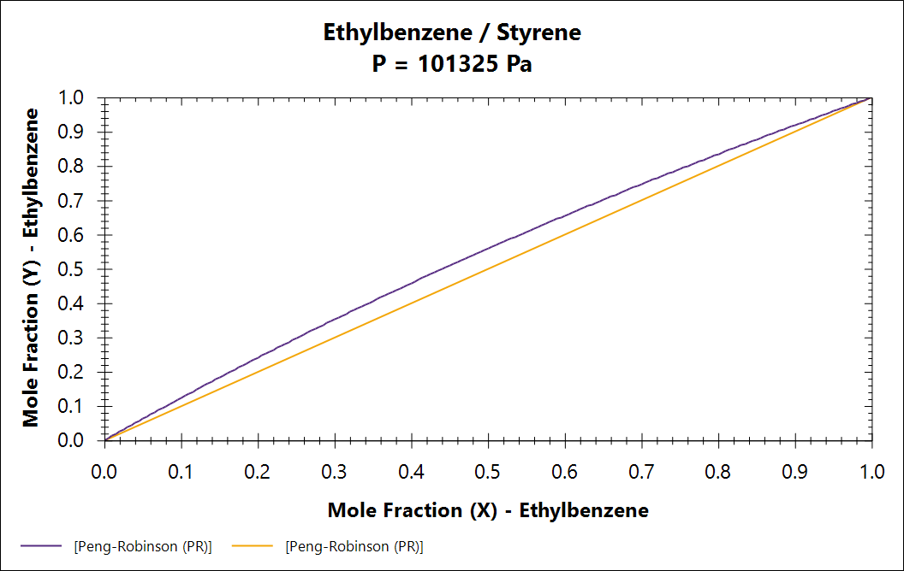

# Styrene Separation Process

## Styrene

- Styrene is an aromatic monomer produced from petroleum-derived feedstocks.
- It is mainly used in the production of polymers such as polystyrene (PS), ABS, and SBR.

### Applications of Polystyrene (PS)

Polystyrene is widely used in:

- Packaging: Food containers, trays, and protective packaging.
- Construction: Thermal insulation materials (EPS and XPS).
- Consumer electronics: Housings for electronic devices.
- Laboratory equipment: Petri dishes and test tubes.

## Reaction

1. Benzene reacts with ethylene to produce ethylbenzene through an alkylation reaction.
2. Styrene is then produced by the catalytic dehydrogenation of ethylbenzene.

$$
\mathrm{C_6H_6+C_2H_4\rightarrow C_8H_{10}}
$$

$$
\mathrm{C_8H_{10}\rightleftharpoons C_8H_8+H_2}
$$

## Physical Properties at Atmospheric Pressure

| Component | Chemical Formula | Boiling Point (°C) |
|---|---|---:|
| Hydrogen | H₂ | -252.9 |
| Ethylene | C₂H₄ | -103.7 |
| Benzene | C₆H₆ | 80.1 |
| Ethylbenzene | C₈H₁₀ | 136.2 |
| Styrene | C₈H₈ | 145.2 |

## Separation Challenge

The boiling-point difference between ethylbenzene and styrene is only about 9°C.

The relative volatility is defined as:

$$
\alpha_{\mathrm{EB/SM}}
=\frac{y_{\mathrm{EB}}/x_{\mathrm{EB}}}
{y_{\mathrm{SM}}/x_{\mathrm{SM}}}
$$

Assuming ideal vapor-liquid equilibrium:

$$
\alpha_{\mathrm{EB/SM}}
\approx
\frac{P_{\mathrm{EB}}^{sat}}
{P_{\mathrm{SM}}^{sat}}
\approx 1.27
$$

*Estimated at approximately 140°C and atmospheric pressure using Raoult's law.*

- Low relative volatility makes conventional distillation challenging.
- A large number of theoretical stages may be required.
- Styrene can polymerize at elevated temperatures, creating an additional design constraint.

**Objective:** Design a distillation process to separate ethylbenzene and styrene efficiently.

## Thermodynamic

Beauty.. like Roulght's law..

# Designing log

- Log of Designing

Assume things at first.

*  Proof ideal stage.
* Assume q-value is 1. Feed's stage is at BUBL point.
* Assume feed has just Ethyl Benzene and Styrene monomer and it's molarity is same. 

